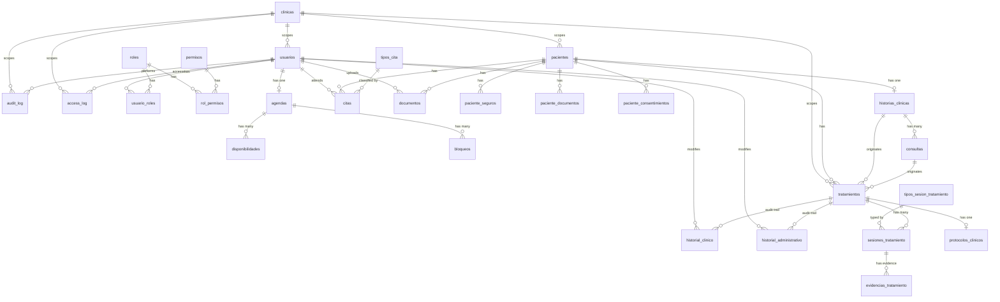

# Medical ERP - Backend Architecture Graph

## 1. MODULE INVENTORY

| # | Module | Package | Entities | Tables | Endpoints | Services | Files | Status |
|---|--------|---------|----------|--------|-----------|----------|-------|--------|
| 1 | **seguridad** | `com.medicalerp.seguridad` | 4 | 5 | 14 | 2 | 20 | 100% |
| 2 | **paciente** | `com.medicalerp.paciente` | 4 | 4 | 24 | 4 | 25 | 100% |
| 3 | **agenda** | `com.medicalerp.agenda` | 4 | 4 | 11 | 1 | 20 | 100% |
| 4 | **cita** | `com.medicalerp.cita` | 1 | 1 | 10 | 1 | 7 | 100% |
| 5 | **historia** | `com.medicalerp.historia` | 1 | 1 | 4 | 1 | 6 | 100% |
| 6 | **consulta** | `com.medicalerp.consulta` | 1 | 1 | 6 | 1 | 11 | 100% |
| 7 | **documento** | `com.medicalerp.documento` | 1 | 1 | 6 | 2 | 8 | 100% |
| 8 | **tratamiento** | `com.medicalerp.tratamiento` | 7 | 7 | 20 | 10 | 48 | 100% |
| 9 | **contacto** | `com.medicalerp.contacto` | 1 | 1 | 6 | 2 | 8 | 100% |
| 10 | **clinica** | `com.medicalerp.clinica` | 1 | 1 | 0 | 0 | 2 | STUB |
| 11 | **auditoria** | `com.medicalerp.auditoria` | 2 | 2 | 0 | 1 | 5 | PARTIAL |
| 12 | **storage** | `com.medicalerp.storage` | 0 | 0 | 0 | 1 | 3 | INFRA |
| 13 | **common** | `com.medicalerp.common` | 0 | 0 | 0 | 0 | 9 | INFRA |
| 14 | **config** | `com.medicalerp.config` | 0 | 0 | 1 | 1 | 6 | INFRA |

**TOTALS: 27 entities | 30 tables | 101 endpoints | 27 services | 189 files**

---

## 2. ENTITY CATALOG (27 ENTITIES)

### 2.1 CLINICA (Root Entity)
- **Table:** `clinicas`
- **Fields:** id, nombre, pais, timezone, moneda, activa, created_at, updated_at
- **Role:** Tenant root - 14 entities reference this via `clinica_id`

### 2.2 SEGURIDAD (4 entities)

#### 2.2.1 Usuario
- **Table:** `usuarios`
- **JPA Relations:**
  - `@ManyToMany Set<Rol> roles` → via join table `usuario_roles`
- **Plain FKs:**
  - `Long clinicaId` → `clinicas.id`
- **Incoming References:** Cita, Agenda, Documento, HistorialClinico, HistorialAdministrativo, AuditLog, AccessLog

#### 2.2.2 Rol
- **Table:** `roles`
- **JPA Relations:**
  - `@ManyToMany Set<Permiso> permisos` → via join table `rol_permisos`

#### 2.2.3 Permiso
- **Table:** `permisos`
- **Fields:** id, nombre, modulo, accion, descripcion
- **Role:** Leaf entity - no outgoing FKs

#### 2.2.4 OtpCode
- **Table:** `otp_codes`
- **Fields:** id, email, codigo, ip_address, user_agent, usado, intentos, expira_at
- **Role:** Standalone - no FK relationships

### 2.3 PACIENTE (4 entities)

#### 2.3.1 Paciente
- **Table:** `pacientes`
- **Plain FKs:**
  - `Long clinicaId` → `clinicas.id`
- **Unique Constraints:** dni
- **Incoming References:** PacienteSeguro, PacienteDocumento, PacienteConsentimiento, HistoriaClinica, Cita, Documento, Tratamiento

#### 2.3.2 PacienteSeguro
- **Table:** `paciente_seguros`
- **JPA Relations:**
  - `@ManyToOne Paciente paciente` → via `paciente_id`
- **Plain FKs:**
  - `Long clinicaId` → `clinicas.id`
- **Soft Delete:** `@Where(clause = "deleted_at IS NULL")` + `deletedAt` field

#### 2.3.3 PacienteDocumento
- **Table:** `paciente_documentos`
- **JPA Relations:**
  - `@ManyToOne Paciente paciente` → via `paciente_id`
- **Plain FKs:**
  - `Long clinicaId` → `clinicas.id`
- **Soft Delete:** `@Where(clause = "deleted_at IS NULL")` + `deletedAt` field

#### 2.3.4 PacienteConsentimiento
- **Table:** `paciente_consentimientos`
- **JPA Relations:**
  - `@ManyToOne Paciente paciente` → via `paciente_id`
- **Plain FKs:**
  - `Long clinicaId` → `clinicas.id`
- **Soft Delete:** `@Where(clause = "deleted_at IS NULL")` + `deletedAt` field

### 2.4 HISTORIA (1 entity)

#### 2.4.1 HistoriaClinica
- **Table:** `historias_clinicas`
- **JPA Relations:**
  - `@OneToOne Paciente paciente` → via `paciente_id` (UNIQUE, NOT NULL)
- **Incoming References:** Consulta, Tratamiento (via plain Long)

### 2.5 CONSULTA (1 entity)

#### 2.5.1 Consulta
- **Table:** `consultas`
- **JPA Relations:**
  - `@ManyToOne HistoriaClinica historia` → via `historia_id`
- **Plain FKs:**
  - `Long citaId` → `citas.id`
- **Incoming References:** Cita, Documento, Tratamiento

### 2.6 CITA (1 entity)

#### 2.6.1 Cita
- **Table:** `citas`
- **JPA Relations:**
  - `@ManyToOne Paciente paciente` → via `paciente_id`
  - `@ManyToOne Usuario usuario` → via `usuario_id`
  - `@ManyToOne TipoCita tipoCita` → via `tipo_cita_id`
- **Plain FKs:**
  - `Long consultaId` → `consultas.id`
  - `Long reprogramadaDe` → `citas.id` (self-reference)

### 2.7 AGENDA (4 entities)

#### 2.7.1 Agenda
- **Table:** `agendas`
- **JPA Relations:**
  - `@OneToOne Usuario usuario` → via `usuario_id` (UNIQUE)
  - `@OneToMany List<Disponibilidad> disponibilidades` → cascade=ALL
  - `@OneToMany List<Bloqueo> bloqueos` → cascade=ALL

#### 2.7.2 Disponibilidad
- **Table:** `disponibilidades`
- **JPA Relations:**
  - `@ManyToOne Agenda agenda` → via `agenda_id`

#### 2.7.3 Bloqueo
- **Table:** `bloqueos`
- **JPA Relations:**
  - `@ManyToOne Agenda agenda` → via `agenda_id`

#### 2.7.4 TipoCita
- **Table:** `tipos_cita`
- **Role:** Catalog entity - no outgoing FKs
- **Incoming References:** Cita

### 2.8 DOCUMENTO (1 entity)

#### 2.8.1 Documento
- **Table:** `documentos`
- **JPA Relations:**
  - `@ManyToOne Paciente paciente` → via `paciente_id`
  - `@ManyToOne Usuario usuario` → via `usuario_id`
- **Plain FKs:**
  - `Long citaId` → `citas.id`
  - `Long consultaId` → `consultas.id`

### 2.9 TRATAMIENTO (7 entities)

#### 2.9.1 Tratamiento
- **Table:** `tratamientos`
- **Plain FKs:**
  - `Long clinicaId` → `clinicas.id`
  - `Long pacienteId` → `pacientes.id`
  - `Long historiaClinicaId` → `historias_clinicas.id`
  - `Long consultaOrigenId` → `consultas.id`
  - `Long usuarioAsignadoId` → `usuarios.id`
- **Enum:** `EstadoTratamiento estado` (PENDIENTE_INICIO, ACTIVO, PAUSADO, FINALIZADO, CANCELADO)
- **Optimistic Lock:** `@Version Integer version`
- **Soft Delete (manual):** `deletedAt` field (no @Where)

#### 2.9.2 SesionTratamiento
- **Table:** `sesiones_tratamiento`
- **Plain FKs:**
  - `Long tratamientoId` → `tratamientos.id`
  - `Long clinicaId` → `clinicas.id`
  - `Long tipoSesionId` → `tipos_sesion_tratamiento.id`

#### 2.9.3 ProtocoloClinico
- **Table:** `protocolos_clinicos`
- **Plain FKs:**
  - `Long tratamientoId` → `tratamientos.id` (UNIQUE - 1:1)
  - `Long clinicaId` → `clinicas.id`

#### 2.9.4 HistorialClinico
- **Table:** `historial_clinico`
- **Plain FKs:**
  - `Long tratamientoId` → `tratamientos.id`
  - `Long clinicaId` → `clinicas.id`
  - `Long usuarioId` → `usuarios.id`

#### 2.9.5 HistorialAdministrativo
- **Table:** `historial_administrativo`
- **Plain FKs:**
  - `Long tratamientoId` → `tratamientos.id`
  - `Long clinicaId` → `clinicas.id`
  - `Long usuarioId` → `usuarios.id`

#### 2.9.6 EvidenciaTratamiento
- **Table:** `evidencias_tratamiento`
- **Plain FKs:**
  - `Long sesionId` → `sesiones_tratamiento.id`
  - `Long clinicaId` → `clinicas.id`

#### 2.9.7 TipoSesionTratamiento
- **Table:** `tipos_sesion_tratamiento`
- **Plain FKs:**
  - `Long clinicaId` → `clinicas.id`
- **Role:** Catalog entity - seed data (7 types)

### 2.10 CONTACTO (1 entity)

#### 2.10.1 MensajeContacto
- **Table:** `mensajes_contacto`
- **Role:** Standalone entity - no FK relationships

### 2.11 AUDITORIA (2 entities)

#### 2.11.1 AuditLog
- **Table:** `audit_log`
- **Plain FKs:**
  - `Long userId` → `usuarios.id`
  - `Long clinicaId` → `clinicas.id`
- **Generic FK:** `entityType` + `entityId` (polymorphic)

#### 2.11.2 AccessLog
- **Table:** `access_log`
- **Plain FKs:**
  - `Long userId` → `usuarios.id`
  - `Long clinicaId` → `clinicas.id`
- **Generic FK:** `entidad` + `entidadId` (polymorphic)

---

## 3. ENTITY RELATIONSHIP DIAGRAM (Mermaid ER)



---

## 4. FOREIGN KEY MATRIX

| Source Entity | Target Table | FK Column | FK Type | Nullable | Cascade |
|---------------|-------------|-----------|---------|----------|---------|
| **Paciente** | clinicas | clinica_id | Plain Long | YES | NONE |
| **PacienteSeguro** | pacientes | paciente_id | JPA @ManyToOne | NO | NONE |
| **PacienteSeguro** | clinicas | clinica_id | Plain Long | NO | NONE |
| **PacienteDocumento** | pacientes | paciente_id | JPA @ManyToOne | NO | NONE |
| **PacienteDocumento** | clinicas | clinica_id | Plain Long | NO | NONE |
| **PacienteConsentimiento** | pacientes | paciente_id | JPA @ManyToOne | NO | NONE |
| **PacienteConsentimiento** | clinicas | clinica_id | Plain Long | NO | NONE |
| **HistoriaClinica** | pacientes | paciente_id | JPA @OneToOne | NO | CASCADE |
| **Consulta** | historias_clinicas | historia_id | JPA @ManyToOne | NO | NONE |
| **Consulta** | citas | cita_id | Plain Long | YES | NONE |
| **Cita** | pacientes | paciente_id | JPA @ManyToOne | NO | NONE |
| **Cita** | usuarios | usuario_id | JPA @ManyToOne | YES | NONE |
| **Cita** | tipos_cita | tipo_cita_id | JPA @ManyToOne | YES | NONE |
| **Cita** | consultas | consulta_id | Plain Long | YES | NONE |
| **Cita** | citas | reprogramada_de | Plain Long | YES | NONE |
| **Agenda** | usuarios | usuario_id | JPA @OneToOne | NO | NONE |
| **Disponibilidad** | agendas | agenda_id | JPA @ManyToOne | NO | NONE |
| **Bloqueo** | agendas | agenda_id | JPA @ManyToOne | NO | NONE |
| **Documento** | pacientes | paciente_id | JPA @ManyToOne | NO | NONE |
| **Documento** | usuarios | usuario_id | JPA @ManyToOne | NO | NONE |
| **Documento** | citas | cita_id | Plain Long | YES | NONE |
| **Documento** | consultas | consulta_id | Plain Long | YES | NONE |
| **Tratamiento** | clinicas | clinica_id | Plain Long | NO | NONE |
| **Tratamiento** | pacientes | paciente_id | Plain Long | NO | RESTRICT |
| **Tratamiento** | historias_clinicas | historia_clinica_id | Plain Long | YES | SET NULL |
| **Tratamiento** | consultas | consulta_origen_id | Plain Long | YES | SET NULL |
| **Tratamiento** | usuarios | usuario_asignado_id | Plain Long | YES | NONE |
| **SesionTratamiento** | tratamientos | tratamiento_id | Plain Long | NO | NONE |
| **SesionTratamiento** | clinicas | clinica_id | Plain Long | NO | NONE |
| **SesionTratamiento** | tipos_sesion_tratamiento | tipo_sesion_id | Plain Long | NO | NONE |
| **ProtocoloClinico** | tratamientos | tratamiento_id | Plain Long | NO | NONE |
| **ProtocoloClinico** | clinicas | clinica_id | Plain Long | NO | NONE |
| **HistorialClinico** | tratamientos | tratamiento_id | Plain Long | NO | NONE |
| **HistorialClinico** | clinicas | clinica_id | Plain Long | NO | NONE |
| **HistorialClinico** | usuarios | usuario_id | Plain Long | NO | NONE |
| **HistorialAdministrativo** | tratamientos | tratamiento_id | Plain Long | NO | NONE |
| **HistorialAdministrativo** | clinicas | clinica_id | Plain Long | NO | NONE |
| **HistorialAdministrativo** | usuarios | usuario_id | Plain Long | NO | NONE |
| **EvidenciaTratamiento** | sesiones_tratamiento | sesion_id | Plain Long | NO | NONE |
| **EvidenciaTratamiento** | clinicas | clinica_id | Plain Long | NO | NONE |
| **TipoSesionTratamiento** | clinicas | clinica_id | Plain Long | NO | NONE |
| **AuditLog** | usuarios | user_id | Plain Long | YES | NONE |
| **AuditLog** | clinicas | clinica_id | Plain Long | YES | NONE |
| **AccessLog** | usuarios | user_id | Plain Long | YES | NONE |
| **AccessLog** | clinicas | clinica_id | Plain Long | NO | NONE |
| **Usuario** | clinicas | clinica_id | Plain Long | YES | NONE |
| **Usuario** | roles | roles | JPA @ManyToMany | - | PERSIST, MERGE |
| **Rol** | permisos | permisos | JPA @ManyToMany | - | NONE |

---

## 5. CROSS-MODULE DEPENDENCY MATRIX

```
              | seg | pac | age | cit | his | con | doc | tra | con | cli | aud | sto | com | cfg |
--------------+-----+-----+-----+-----+-----+-----+-----+-----+-----+-----+-----+-----+-----+-----|
seguridad     |  -  |     |     |     |     |  X  |     |     |     |  X  |  X  |     |  X  |     |
paciente      |     |  -  |     |     |     |     |     |     |     |  X  |  X  |     |  X  |  X  |
agenda        |  X  |     |  -  |     |     |     |     |     |     |     |     |     |  X  |     |
cita          |  X  |  X  |  *  |  -  |     |     |     |     |     |     |     |     |  X  |     |
historia      |     |  X  |     |     |  -  |     |     |     |     |     |     |     |  X  |     |
consulta      |     |     |     |     |  X  |  -  |     |     |     |     |     |     |  X  |     |
documento     |  X  |  X  |     |     |     |     |  -  |     |     |     |     |     |  X  |     |
tratamiento   |  X  |     |  X  |  X  |     |     |     |  -  |     |     |     |  X  |  X  |     |
contacto      |     |     |     |     |     |     |     |     |  -  |     |     |     |  X  |     |
clinica       |     |     |     |     |     |     |     |     |     |  -  |     |     |     |     |
auditoria     |     |     |     |     |     |     |     |     |     |     |  -  |     |     |     |
storage       |     |     |     |     |     |     |     |     |     |     |     |  -  |     |     |
common        |  X  |     |     |     |     |     |     |     |     |     |     |     |  -  |     |
config        |  X  |     |     |     |     |     |     |     |     |     |     |     |  X  |  -  |
```

**Legend:** `X` = direct dependency, `*` = entity-only import, blank = no dependency

---

## 6. SOFT DELETE STRATEGY

| Entity | @Where | deletedAt Field | Method |
|--------|--------|----------------|--------|
| PacienteSeguro | YES | YES | Dual |
| PacienteDocumento | YES | YES | Dual |
| PacienteConsentimiento | YES | YES | Dual |
| Tratamiento | NO | YES | Manual (no auto-filter) |
| Paciente | NO | NO | Uses `estado="inactivo"` |

---

## 7. MULTI-TENANT ARCHITECTURE

- **Root Entity:** `clinicas` (Tenant Root)
- **FK Pattern:** Plain `Long clinicaId` → `clinicas.id` (no JPA @ManyToOne)
- **Scope Method:** `SecurityUtils.getCurrentClinicaId()` from JWT

### Entities WITH clinica_id (14):
Paciente, PacienteSeguro, PacienteDocumento, PacienteConsentimiento, Usuario, Tratamiento, SesionTratamiento, ProtocoloClinico, HistorialClinico, HistorialAdministrativo, EvidenciaTratamiento, TipoSesionTratamiento, AuditLog, AccessLog

### Entities WITHOUT clinica_id (13):
HistoriaClinica, Consulta, Cita, Agenda, Disponibilidad, Bloqueo, TipoCita, Documento, MensajeContacto, OtpCode, Rol, Permiso, Clinica

---

## 8. API ENDPOINTS (101 TOTAL)

### 8.1 Seguridad (14 endpoints)
| Method | Path | Auth | Description |
|--------|------|------|-------------|
| POST | /api/v1/auth/login | PUBLIC | Login with password |
| POST | /api/v1/auth/login-step1 | PUBLIC | OTP step 1 |
| POST | /api/v1/auth/login-step2 | PUBLIC | OTP step 2 |
| POST | /api/v1/auth/resend-otp | PUBLIC | Resend OTP |
| POST | /api/v1/auth/refresh | PUBLIC | Refresh token |
| GET | /api/v1/auth/me | AUTH | Current user |
| GET | /api/v1/usuarios | ADMIN | List users |
| GET | /api/v1/usuarios/{id} | ADMIN | Get user |
| POST | /api/v1/usuarios | ADMIN | Create user |
| PUT | /api/v1/usuarios/{id} | ADMIN | Update user |
| DELETE | /api/v1/usuarios/{id} | ADMIN | Delete user |
| PATCH | /api/v1/usuarios/{id}/activate | ADMIN | Activate user |
| PATCH | /api/v1/usuarios/{id}/deactivate | ADMIN | Deactivate user |
| POST | /api/v1/usuarios/{id}/reset-password | ADMIN | Reset password |

### 8.2 Paciente (24 endpoints)
| Method | Path | Auth | Description |
|--------|------|------|-------------|
| POST | /api/v1/pacientes | DOC,ENF,ADM | Create basic |
| POST | /api/v1/pacientes/full | DOC,ENF,ADM | Create complete |
| GET | /api/v1/pacientes | DOC,ENF,ADM | List paginated |
| GET | /api/v1/pacientes/{id} | DOC,ENF,ADM | Get by ID |
| PUT | /api/v1/pacientes/{id} | DOC,ENF,ADM | Update basic |
| PUT | /api/v1/pacientes/full/{id} | DOC,ENF,ADM | Update complete |
| DELETE | /api/v1/pacientes/{id} | DOC,ADM | Soft delete |
| GET | /api/v1/pacientes/buscar?q= | DOC,ENF,ADM | Search |
| GET | /api/v1/pacientes/estado/{e} | DOC,ENF,ADM | By status |
| POST | /api/v1/pacientes/{id}/seguros | DOC,ENF,ADM | Create seguro |
| GET | /api/v1/pacientes/{id}/seguros | DOC,ENF,ADM | List seguros |
| GET | /api/v1/pacientes/{id}/seguros/{sid} | DOC,ENF,ADM | Get seguro |
| PUT | /api/v1/pacientes/{id}/seguros/{sid} | DOC,ADM | Update seguro |
| DELETE | /api/v1/pacientes/{id}/seguros/{sid} | DOC,ADM | Delete seguro |
| POST | /api/v1/pacientes/{id}/documentos | DOC,ENF,ADM | Create documento |
| GET | /api/v1/pacientes/{id}/documentos | DOC,ENF,ADM | List documentos |
| GET | /api/v1/pacientes/{id}/documentos/{did} | DOC,ENF,ADM | Get documento |
| PUT | /api/v1/pacientes/{id}/documentos/{did} | DOC,ADM | Update documento |
| DELETE | /api/v1/pacientes/{id}/documentos/{did} | DOC,ADM | Delete documento |
| POST | /api/v1/pacientes/{id}/consentimientos | DOC,ENF,ADM | Create consent |
| GET | /api/v1/pacientes/{id}/consentimientos | DOC,ENF,ADM | List consents |
| GET | /api/v1/pacientes/{id}/consentimientos/{cid} | DOC,ENF,ADM | Get consent |
| PUT | /api/v1/pacientes/{id}/consentimientos/{cid} | DOC,ADM | Update consent |
| DELETE | /api/v1/pacientes/{id}/consentimientos/{cid} | DOC,ADM | Delete consent |

### 8.3 Agenda (11 endpoints)
| Method | Path | Auth | Description |
|--------|------|------|-------------|
| POST | /api/v1/agendas | DOC,ADM | Create agenda |
| GET | /api/v1/agendas | DOC,ENF,ADM | List agendas |
| GET | /api/v1/agendas/{id} | DOC,ENF,ADM | Get agenda |
| PUT | /api/v1/agendas/{id} | DOC,ADM | Update agenda |
| POST | /api/v1/agendas/{id}/disponibilidades | DOC,ADM | Add disponibilidad |
| DELETE | /api/v1/agendas/{id}/disponibilidades/{did} | DOC,ADM | Remove disponibilidad |
| POST | /api/v1/agendas/{id}/bloqueos | DOC,ADM | Add bloqueo |
| DELETE | /api/v1/agendas/{id}/bloqueos/{bid} | DOC,ADM | Remove bloqueo |
| GET | /api/v1/tipos-cita | DOC,ENF,ADM | List tipos cita |
| POST | /api/v1/tipos-cita | DOC,ADM | Create tipo cita |
| PUT | /api/v1/tipos-cita/{id} | DOC,ADM | Update tipo cita |

### 8.4 Cita (10 endpoints)
| Method | Path | Auth | Description |
|--------|------|------|-------------|
| POST | /api/v1/citas | DOC,ENF,ADM | Create cita |
| GET | /api/v1/citas | DOC,ENF,ADM | List citas |
| GET | /api/v1/citas/{id} | DOC,ENF,ADM | Get cita |
| PUT | /api/v1/citas/{id} | DOC,ENF,ADM | Update cita |
| DELETE | /api/v1/citas/{id} | DOC,ADM | Cancel cita |
| GET | /api/v1/citas/hoy | DOC,ENF,ADM | Today's citas |
| GET | /api/v1/citas/proximas | DOC,ENF,ADM | Upcoming citas |
| PATCH | /api/v1/citas/{id}/confirmar | DOC,ENF,ADM | Confirm attendance |
| PATCH | /api/v1/citas/{id}/asistencia | DOC,ENF,ADM | Mark attendance |
| PATCH | /api/v1/citas/{id}/completar | DOC,ENF,ADM | Complete cita |

### 8.5 Historia (4 endpoints)
| Method | Path | Auth | Description |
|--------|------|------|-------------|
| POST | /api/v1/historias | DOC,ENF,ADM | Create historia |
| GET | /api/v1/historias/{id} | DOC,ENF,ADM | Get by ID |
| GET | /api/v1/historias/paciente/{pid} | DOC,ENF,ADM | Get by paciente |
| PUT | /api/v1/historias/{id} | DOC,ENF,ADM | Update historia |

### 8.6 Consulta (6 endpoints)
| Method | Path | Auth | Description |
|--------|------|------|-------------|
| POST | /api/v1/consultas | DOC,ENF,ADM | Create consulta |
| GET | /api/v1/consultas/{id} | DOC,ENF,ADM | Get by ID |
| GET | /api/v1/consultas/historia/{hid} | DOC,ENF,ADM | By historia |
| PUT | /api/v1/consultas/{id} | DOC,ENF,ADM | Update consulta |
| DELETE | /api/v1/consultas/{id} | DOC,ADM | Delete consulta |
| PATCH | /api/v1/consultas/{id}/firmar | DOC,ADM | Sign consulta |

### 8.7 Documento (6 endpoints)
| Method | Path | Auth | Description |
|--------|------|------|-------------|
| POST | /api/v1/documentos | DOC,ENF,ADM | Create documento |
| GET | /api/v1/documentos/{id} | DOC,ENF,ADM | Get by ID |
| GET | /api/v1/documentos/paciente/{pid} | DOC,ENF,ADM | By paciente |
| GET | /api/v1/documentos/{id}/pdf | DOC,ENF,ADM | Download PDF |
| PATCH | /api/v1/documentos/{id}/firmar | DOC,ADM | Sign documento |
| DELETE | /api/v1/documentos/{id} | DOC,ADM | Delete documento |

### 8.8 Tratamiento (20 endpoints)
| Method | Path | Auth | Description |
|--------|------|------|-------------|
| POST | /api/v1/tratamientos | DOC,ADM | Create tratamiento |
| GET | /api/v1/tratamientos | DOC,ENF,ADM | List paginated |
| GET | /api/v1/tratamientos/{id} | DOC,ENF,ADM | Get by ID |
| PUT | /api/v1/tratamientos/{id} | DOC,ADM | Update plan |
| PATCH | /api/v1/tratamientos/{id}/estado | DOC,ADM | Change state |
| PATCH | /api/v1/tratamientos/{id}/ampliar | DOC,ADM | Expand plan |
| GET | /api/v1/tratamientos/paciente/{pid} | DOC,ENF,ADM | By paciente |
| GET | /api/v1/tratamientos/estado/{e} | DOC,ENF,ADM | By status |
| GET | /api/v1/tratamientos/activos | DOC,ENF,ADM | Active list |
| GET | /api/v1/tratamientos/buscar?q= | DOC,ENF,ADM | Search |
| GET | /api/v1/tratamientos/{id}/protocolo | DOC,ENF,ADM | Get protocolo |
| PUT | /api/v1/tratamientos/{id}/protocolo | DOC,ADM | Update protocolo |
| POST | /api/v1/tratamientos/{id}/sugerir-proxima-cita | DOC,ENF,ADM | Suggest next cita |
| GET | /api/v1/tratamientos/{id}/historial/clinico | DOC,ENF,ADM | Clinical history |
| GET | /api/v1/tratamientos/{id}/historial/administrativo | DOC,ENF,ADM | Admin history |
| POST | /api/v1/sesiones-tratamiento?tratamientoId= | DOC,ADM | Create session |
| GET | /api/v1/sesiones-tratamiento/{id} | DOC,ENF,ADM | Get session |
| GET | /api/v1/sesiones-tratamiento/tratamiento/{tid} | DOC,ENF,ADM | Sessions by treatment |
| GET | /api/v1/tipos-sesion-tratamiento | DOC,ENF,ADM | List session types |
| GET | /api/v1/tratamientos/dashboard | DOC,ENF,ADM | Dashboard stats |

### 8.9 Contacto (6 endpoints)
| Method | Path | Auth | Description |
|--------|------|------|-------------|
| POST | /api/v1/contact | PUBLIC | Send message |
| GET | /api/v1/contact | ADMIN | List messages |
| GET | /api/v1/contact/{id} | ADMIN | Get message |
| PATCH | /api/v1/contact/{id}/leido | ADMIN | Mark read |
| PATCH | /api/v1/contact/{id}/respondido | ADMIN | Mark responded |
| DELETE | /api/v1/contact/{id} | ADMIN | Delete message |

### 8.10 Config (1 endpoint)
| Method | Path | Auth | Description |
|--------|------|------|-------------|
| GET | /api/v1/config/paises | PUBLIC | Get country configs |

---

## 9. BUSINESS RULES

### Paciente Rules
- VR-PAC-001: User must have clinica assigned
- VR-PAC-008: Birth date cannot be future
- VR-PAC-009: Document type must be valid for country
- VR-DOC-001-006: Document validation (type, pattern, duplicates, max 1 principal)
- VR-SEG-001: Insurance required in US
- VR-CON-001: Consents required in US

### Tratamiento Rules
- BR-TRAT-001: Cannot have duplicate active treatment of same type
- BR-TRAT-002: Can only start treatment in PENDIENTE_INICIO
- BR-TRAT-005: Can only pause treatment in ACTIVO
- BR-TRAT-006: Can only resume treatment in PAUSADO
- BR-TRAT-007: Can only finalize in ACTIVO or PAUSADO
- BR-TRAT-007b: Requires resultado final to finalize
- BR-TRAT-008: Cannot cancel FINALIZADO or CANCELADO
- BR-TRAT-008b: Requires motivo to cancel

### Cita Rules
- Cannot create overlapping citas for same usuario
- Cannot create cita in the past
- Requires valid paciente and tipo_cita

---

## 10. SQL MIGRATIONS

| Version | Description | Tables Created | Modules |
|---------|-------------|----------------|---------|
| V1 | Users, roles, permissions | usuarios, roles, permisos, usuario_roles, rol_permisos | seguridad |
| V2 | Agenda tables | agendas, disponibilidades, bloqueos, tipos_cita | agenda |
| V3 | Patients | pacientes | paciente |
| V4 | Clinical records | historias_clinicas, consultas, documentos | historia, consulta, documento |
| V5 | Appointments | citas | cita |
| V6 | Contact messages | mensajes_contacto | contacto |
| V7 | Audit log | audit_log | auditoria |
| V8 | Seed admin | (seed data) | seguridad |
| V9 | Circular FKs | FK constraints | cita, consulta, documento |
| V10 | OTP codes | otp_codes | seguridad |
| V11 | Multi-region | clinicas, paciente_documentos, paciente_seguros, paciente_consentimientos, access_log | clinica, paciente, auditoria |
| V16 | Treatment module | tipos_sesion_tratamiento, tratamientos, protocolos_clinicos, sesiones_tratamiento, evidencias_tratamiento, historial_clinico, historial_administrativo | tratamiento |

---

## 11. TECHNOLOGY STACK

- **Java:** 21
- **Spring Boot:** 3.2.0
- **Spring Data JPA:** With Hibernate
- **Database:** MySQL 8.0
- **Migrations:** Flyway (V1-V16)
- **ORM:** Hibernate with Lombok
- **Mappers:** MapStruct 1.5.5
- **PDF Generation:** iText 7.2.5
- **JWT:** jjwt 0.12.3
- **Auth:** OTP + JWT (access: 1hr, refresh: 7days)
- **Multi-tenant:** clinica_id from JWT
- **Soft Delete:** @Where + deletedAt field

---

## 12. ARCHITECTURAL PATTERNS

1. **Multi-tenant:** clinica_id scoping via JWT
2. **Soft Delete:** @Where clause + deletedAt field (4 entities)
3. **Dual FK Pattern:** JPA @ManyToOne + Plain Long (mixed)
4. **Two-phase Validation:** Validate all before insert
5. **Replace-all Strategy:** Full update replaces all children
6. **@Auditable:** AOP-based audit trail
7. **PaisConfig:** Country-specific validation
8. **StorageStrategy:** Pluggable file storage interface
9. **ClinicalRuleEngine:** Extensible rule interface
10. **TreatmentWorkflowService:** Orchestration pattern
